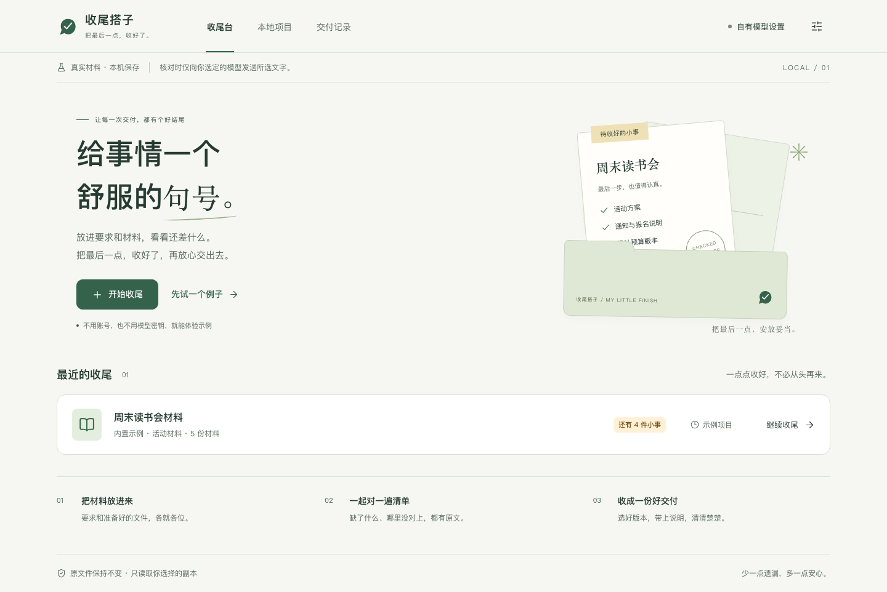
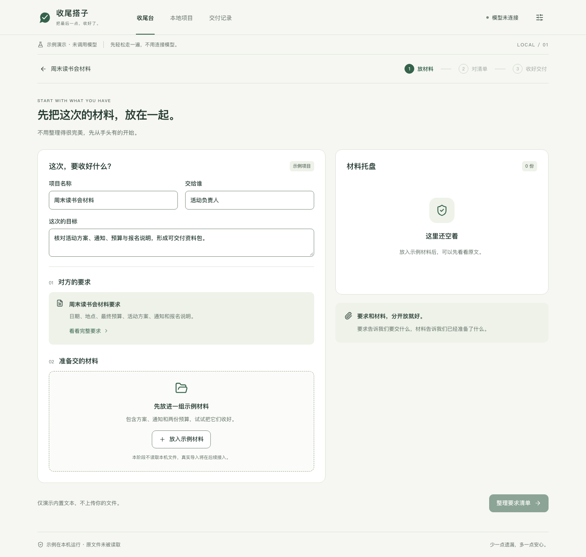
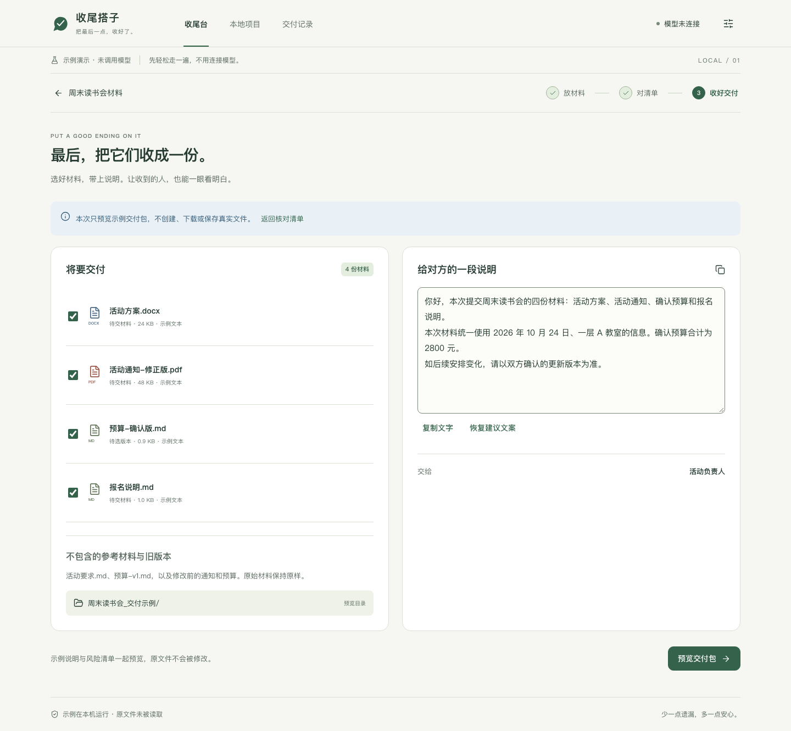
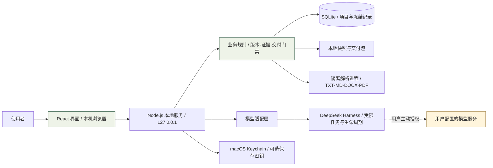

<div align="center">


# 收尾搭子 · Shouwei Buddy

**交出去之前，一起把最后几件事收好。**

**基于 DeepSeek Harness 构建的本地 AI 收尾工作台。** 放入要求和材料，通过受控的模型任务、可追溯证据与交付规则，找到遗漏与冲突，完成最后一次检查。


[怎么使用](#怎么使用) · [手动启动](#快速开始) · [界面预览](#界面预览) · [系统架构](#系统架构) · [使用指南](docs/getting-started.md) · [参与开发](CONTRIBUTING.md)

</div>



> **暂时仅支持 Mac（Apple Silicon）。Windows 暂不支持，Intel Mac 与 Linux 尚未验证。**
> 当前为 `0.1.0-rc.1` 开源预览版，实测环境为 macOS 26.2。本仓库提供源码运行方式；预编译应用尚未作为正式安装包发布。

## 怎么使用

### 交给你的 Agent 安装（推荐）

**复制下面整段，发给能操作你本机终端的 AI Agent。** 它会检查环境、下载项目、安装依赖并启动网页，再引导你配置自己的模型。普通聊天窗口无法代替你操作电脑；没有本机操作能力时，可按下方 [手动启动步骤](#快速开始) 操作。

```text
请帮我在这台 Mac 上安装并启动「收尾搭子」，一直协助到打开模型设置页，不要只给我一份安装教程。

项目地址：https://github.com/shianlab/shouwei-buddy

请按以下顺序操作：

1. 检查系统和芯片。当前仅支持 Apple Silicon Mac，实测 macOS 26.2，其他 macOS 版本尚未验证。Windows、Intel Mac、Linux 请停止安装并说明限制。

2. 检查 Git、Node.js 和 npm。项目验证版本为 Node.js 24.15.0，pnpm 固定为 11.28.5。缺少环境时，协助安装到用户范围；需要系统安装授权时说明原因。不擅自替换已有全局环境。

3. 在合适的用户目录下载仓库，读取 README 和 docs/getting-started.md。已有同名目录时先确认来源，不覆盖文件或丢弃本地修改。如果收尾搭子已经运行，优先复用现有服务，不重复启动。

4. 在项目目录依次运行：
   npm exec --yes --package=pnpm@11.28.5 -- pnpm install --frozen-lockfile
   npm exec --yes --package=pnpm@11.28.5 -- pnpm start
   首次构建需要等待。使用可持续运行的终端保留服务，并告诉我在哪里停止它。发生错误时根据实际日志排查，不跳过失败步骤或改业务代码来假装安装成功。

5. 确认本地网页可访问，打开 http://127.0.0.1:4317/local/model 。若端口被其他应用占用，不结束陌生进程；确认没有本项目实例运行后，可用 SHOUWEI_PORT=4319 启动并打开对应地址。不要将服务暴露到公网，也不要绕过数据目录锁。

6. 引导我配置模型：询问我准备使用的服务商，协助核对兼容的服务地址、模型 ID、上下文容量和输出上限，不猜测模型规格。API Key 由我直接在本机网页输入并保存，不让我发到聊天，不读取或记录密钥，不写入仓库、命令或日志。默认密钥仅保留在本次服务内存；如果我需要重启后保留，再按使用指南协助启用 macOS Keychain。

7. 保存配置后，只确认界面已保存。不要自动点「测试连接」，不要运行 verify:model，也不要自动抽取或核对材料。这些操作可能收费，只有我明确要求后才能执行。未实际调用模型时，说明连接尚未经过真实请求验证。

8. 告诉我：首页「先试一个例子」无需模型即可体验；正式使用依次是新建项目、导入材料、确认要求、AI 核对、处理问题、生成交付包。让我自己选择何时开始付费的 AI 操作。

完成后，请给我：实际安装目录、网页地址、下次启动命令、停止方式，以及密钥是否需要重新填写。若还有阻塞，明确告诉我具体卡在哪里和最小下一步，不把未完成的步骤说成已完成。
```

**你需要准备的只有：支持的 Mac、能操作本机的 Agent，以及自己的模型服务配置。** 安装依赖需要联网；服务启动后在本机浏览器使用，无需注册本应用账户。密钥直接填在网页里，**保存配置不收费，主动测试连接或使用 AI 功能可能产生模型费用**。

首次引导完成后，保留 Agent 给出的启动命令即可。关闭网页不会停止后台服务；默认仅本次保存的密钥，在服务重启后需要重新填写。[详细使用指南 →](docs/getting-started.md)

## 为什么做这个

一份方案已经写完，真正让人不放心的，往往是最后几件小事：通知里的日期与方案不一致、预算还留着“待定”、附件少了一份、两个版本不知道该交哪一个。

收尾搭子围绕这一步工作：**先确认要求，再核对材料，让每个提醒都能回到原文，最后整理成一份可以交出去的包。** 你负责确认与取舍，模型提供候选发现，程序负责证据校验和交付门禁。

适合活动方案、项目汇报、课程作业、客户提案等包含多份文字材料的交付前检查。

## DeepSeek Harness 在这里做什么

收尾搭子把一项检查组织成有输入范围、有生命周期、有证据约束的工作流。**DeepSeek Harness 是实际调用的任务运行时**，通过独立适配层连接 SDK；文件、规则与交付状态由应用自身管理。

| 层次 | 本项目的实现 | 对使用者的意义 |
|---|---|---|
| Harness 执行层 | SDK 驱动受限任务，处理模型连接、超时、取消与进程退出 | 任务可以停止，失败有明确状态；模型不获得任意文件或终端工具 |
| 证据校验层 | 结构化输出校验，再核对候选引用是否属于本次选定材料 | 提醒可以回到原文，编造的引用不会直接变成有效问题 |
| 状态与恢复层 | SQLite、版本快照、revision、检查点与人工决策 | 新版本不会悄悄沿用旧结论，中断后能保留已记录的工作 |
| 交付规则层 | 程序核验必需项、范围、版本和附件哈希 | 是否可以交付有可检查的规则，最终确认仍由你完成 |

实际执行链路是 **确认要求 → Harness 分批核对 → 程序验引文 → 人工处理 → 重新检查 → 规则放行 → 冻结交付**。框架负责运行模型任务，产品负责把它收敛为一个完整、可追踪的交付流程。[查看架构与代码入口 →](docs/architecture.md)

## 能做什么

| 能力 | 具体行为 |
|---|---|
| 材料托盘 | 导入 TXT、Markdown、DOCX、PDF，区分要求、待交付材料和参考资料 |
| 要求确认 | 从要求材料提取候选清单，支持手写补充；确认后再开始核对 |
| 证据核对 | 提醒日期冲突、遗漏、占位文字及版本歧义；查看原文行、段落或页码 |
| 人工处理 | 修改原件后导入新版本、重新核对，或记录明确的风险接受理由 |
| 交付闭环 | 选择附件、生成带摘要的 ZIP，单独保存自己的 HTML 检查报告 |
| 本地管理 | 项目和历史保存在本机，支持确认删除、配置恢复及脱敏诊断预览 |

材料副本与原件分开保存。查看、整理、导出和内置示例无需模型；**主动进行 AI 抽取或核对时，才把所选文字发送到你配置的模型服务。**

## 快速开始

准备一台 Apple Silicon Mac，以及 **Node.js 24.15.0**（当前验证版本，含 npm）。开发依赖通过锁文件安装，不需要全局安装 pnpm。

```bash
git clone https://github.com/shianlab/shouwei-buddy.git
cd shouwei-buddy

npm exec --yes --package=pnpm@11.28.5 -- pnpm install --frozen-lockfile
npm exec --yes --package=pnpm@11.28.5 -- pnpm start
```

打开 **[http://127.0.0.1:4317](http://127.0.0.1:4317)**。首次构建完成后即可使用；停止服务，在原终端按 `Ctrl+C`。

1. **先体验**：首页点击「先试一个例子」，无需账户或 Key，走一遍固定的读书会示例。
2. **放入自己的材料**：点击「开始收尾」，新建项目，导入文件并读取文字。
3. **配置自己的模型**：在「自有模型设置」填写服务地址、模型 ID、容量和密钥，再主动抽取或核对。
4. **交付**：确认要求、处理问题、选择附件，生成 ZIP 与独立检查报告。

普通模型参数自动保存在本机。Key 默认只在本次服务内存；需要 macOS Keychain 持久保存时，先按 [使用指南](docs/getting-started.md#保存模型密钥) 编译辅助程序，再在界面明确勾选。**保存配置和重启不会自动测试模型；“测试连接”与 AI 核对可能产生模型费用。**

## 界面预览

纸白底色、鼠尾草绿、文件夹与证据卡片，让一次材料检查保持清晰、安静。以下均为真实应用界面截图，使用内置合成示例，**没有调用真实模型，也不表示真实模型准确率**。

<details open>
<summary><strong>① 放好材料——让要求、方案和参考资料各就各位</strong></summary>



</details>

<details open>
<summary><strong>② 对照证据——每个问题都能回到原文</strong></summary>


</details>

<details>
<summary><strong>③ 收好交付——检查结果、附件与说明集中确认</strong></summary>



</details>

## 系统架构



| 模块 | 职责 |
|---|---|
| `apps/web` | React + Vite 界面、示例流程、证据与交付交互 |
| `apps/server` | 本机 HTTP API、配置、受控模型请求与进程生命周期 |
| `packages/core` | SQLite、材料解析、版本与 revision、规则、导出及恢复 |
| `packages/contracts` | 跨层类型、输入校验与结构化输出约束 |
| `packages/harness-adapter` | DeepSeek Harness SDK 接入、凭据引用、取消与超时 |
| `native` | macOS 启动器和 Keychain 辅助程序 |

模型产生候选结果，程序校验证据、范围和状态；未完成检查或存在技术缺口时，不会被模型一句“可以交付”放行。更多数据流、存储和信任边界见 [架构说明](docs/architecture.md)。

## 数据与模型

- 默认数据目录：`~/Library/Application Support/Shouwei Buddy/`，不写到 Git 仓库，不自动同步或遥测。
- 文件只读取用户导入的副本；模型没有终端、网页浏览或任意文件读写工具。
- 支持 **OpenAI Chat Completions 兼容协议**。这里是接口格式名称；运行模型由你自行选择，不绑定制作时使用的模型。
- 删除项目保留原件、已完成交付及迁移备份，不能用于彻底擦除私人信息。
- 检查报告与收件人的 ZIP 分开生成，供你决定分别分享给谁。

详见 [安全说明](SECURITY.md) 与 [本地数据和备份](docs/local-data.md)。

## 当前边界

| 项目 | 当前状态 |
|---|---|
| Mac / Apple Silicon | **唯一支持平台**；macOS 26.2 实测，其他版本待验 |
| Windows / Intel Mac / Linux | 暂不支持，未承诺下载即用 |
| 签名、公证、干净系统安装 | 待完成；不要通过关闭系统保护绕过拦截 |
| PDF | 支持文字层；扫描件无 OCR，加密文件需先自行解密 |
| Office | 提取正文和表格；复杂版面、图片、批注等会提示覆盖缺口 |
| 容量 | 每项目最多 30 份快照 / 100 MiB，单份最多 20 MiB；详细解析限额见指南 |
| 真实模型质量 | 需要结合自己的材料验收；合成测试不能证明准确率 |

当前本地自动验收为 **125 项单元/集成测试、18 项浏览器测试通过**，另有类型、依赖审计和应用包验收。测试使用本机合成模型，不消耗个人模型 Key。详见 [验证记录](docs/verification.md)、[已知限制](docs/known-limitations.md) 与 [发行清单](docs/release-checklist.md)。

## 创作与致谢

项目由 **时安 / [shianlab](https://github.com/shianlab)** 发起。

**作者提供的制作说明：使用豆包 Seed 2.1 Pro 辅助制作。** 这项说明描述创作工具，不代表应用运行时绑定该模型，也不构成模型厂商的官方背书。

运行时基于 DeepSeek Harness，界面使用 React、Vite 与 Lucide，文档处理使用 PDF.js、fast-xml-parser 和 fflate。感谢这些开源项目；原有协议名称和第三方归属按实际依赖保留。

## 贡献与许可

欢迎提交可复现的问题和改进建议。请先阅读 [贡献指南](CONTRIBUTING.md)，通过 [Issues](https://github.com/shianlab/shouwei-buddy/issues) 反馈；不要附上真实密钥、私人材料或数据库。

项目自身代码采用 [MIT License](LICENSE)。第三方软件保留各自许可，详见 [第三方说明](THIRD_PARTY_NOTICES.md)。本仓库公开源码；含传递二进制依赖的预编译安装包还需完成独立发行门禁。
