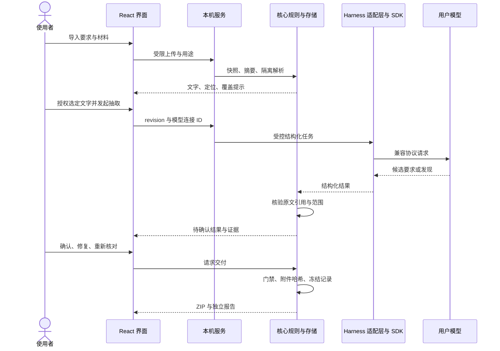

# 架构说明

收尾搭子基于 **DeepSeek Harness** 执行模型任务，把材料、要求、候选发现、人工决定与最终交付连接成受控工作流。界面运行在浏览器；本机 Node.js 服务管理状态、模型会话、解析和导出。当前支持 macOS Apple Silicon。

## 三条职责边界

**Harness 管执行。** `packages/harness-adapter` 使用固定版本的 dsh SDK，建立受限任务，处理连接、结构化回复、超时、取消及子进程退出。模型只接收本次选定的输入，没有任意文件、Shell 或网页工具。底层框架具备的其他能力不等于本应用已启用的能力。

**应用管真实性和状态。** `packages/contracts` 校验结构，`packages/core` 核验原文引用、输入版本、范围和结论门禁。模型返回一段结构正确的 JSON，仍需通过实际引文和业务约束。SQLite 保存检查点、版本、问题与人工决定。

**使用者管确认与交付。** 抽取结果需确认；风险接受需理由；技术缺口、附件哈希失败及未完成检查不能被风险理由绕过。应用不会自动改写用户原件，也不把模型判断当成最终签收。

## 一次检查的数据流

## 代码入口

| 路径 | 责任 |
|---|---|
| [apps/web/src](../apps/web/src) | 界面状态、示例与真实数据路由、用户确认 |
| [apps/server/src/server.ts](../apps/server/src/server.ts) | HTTP 输入边界、项目/模型/交付 API |
| [apps/server/src/model.ts](../apps/server/src/model.ts) | 会话级凭据、普通配置、Harness 会话和模型调用 |
| [packages/harness-adapter/src](../packages/harness-adapter/src) | SDK 运行时连接、凭据引用、回复和取消 |
| [packages/core/src](../packages/core/src) | SQLite、文件、解析、检查规则与交付 |
| [packages/contracts/src](../packages/contracts/src) | 共享类型与边界 Schema |
| [native](../native) | macOS 启动器、Keychain 原生辅助程序 |
| [runtime/shouwei.patch.yml](../runtime/shouwei.patch.yml) | 本应用的受限运行时模板 |

`apps/desktop` 保留早期 Electron 基线验证入口；当前用户入口是浏览器与本机服务，macOS 候选启动器位于 native。

## 持久化与一致性

SQLite 当前 schema 4，迁移前创建可独立打开的备份。项目写入共用队列并检查 revision；并行页面提交旧版本会被拒绝。材料以随机快照 ID 和 SHA-256 绑定，避免用用户文件名拼路径。

检查结果绑定材料与要求版本。更新输入后，旧结果不能直接作为当前结论。交付记录冻结当时的要求、选择、理由与附件摘要；生成结束再次核验哈希，历史下载不依赖之后修改的项目名称。

删除项目解除工作数据关联，保留完成交付。清理日志采用原子替换；非法日志保留且逐条隔离，不让一个损坏记录阻断全部启动。模型会话有归属标记，只有归属明确、进程退出确认且路径安全时才清理；未知残留不猜测删除。

## 输入与隐私边界

HTTP 仅监听回环地址，校验 Host、Origin 和请求标记。这不是公开服务器或同一系统账户之间的权限隔离方案。

解析在受限子进程执行，限制文件大小、展开数量、页数、文字量、时间及 V8 堆；这些限制不等于完整的操作系统沙箱。模型输入是材料数据，输出以纯文本或转义 HTML 展示。

普通模型参数写入本机配置。Key 默认为会话内存，macOS 可选择 Keychain。原生 helper 使用 stdin；Harness 的专用子进程按 SDK 协议临时从环境获得 Key，同一系统用户可以检查该进程环境。诊断导出只含白名单计数与状态。

## 实现范围

这里实现的是一条可核验的材料交付流程，不承诺启用 Harness 的全部工具、任意多智能体协作、自动文件修复或所有厂商原生模型协议。示例演示、合成模型测试和真实模型业务质量分别记录。下一步平台与发行门禁见 [发行清单](release-checklist.md)。
